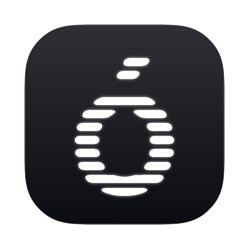

<div align="center">
  
  <h1>Ombú</h1>
  <p><strong>A personal macOS terminal for working alongside coding agents.</strong></p>
  <p>
    
    
    
  </p>
</div>

Ombú is the terminal I wanted for my own days: several projects open at once, a Claude or Codex session running in most of them, and a sidebar that tells me at a glance which one needs me. It is native, GPU-fast thanks to [libghostty](https://github.com/ghostty-org/ghostty), and shaped around one person's workflow rather than everyone's.

## Install

Download `Ombú-<version>.zip` from the [Releases page](https://github.com/estudio-buenasuerte/ombu/releases), unzip it, and drag Ombú to Applications. It's signed and notarized, and needs macOS 15 or later.

## Where it comes from

Ombú stands on two terminals I admire.

[**Flow**](https://getflowterm.app) by [thetinygoat](https://github.com/thetinygoat/flow) showed me how good a terminal feels when each project is a workspace with its own tabs, and when a small coloured dot can carry the whole state of an agent: working, waiting for you, done. Ombú's first incarnation was a fork of Flow, and that era lives on in the [`appkit`](../../tree/appkit) branch.

[**Enso**](https://github.com/amanfromsolan/enso) by [Aman](https://github.com/amanfromsolan) then arrived with the sidebar, spaces, splits, command palette and agent-aware tabs that I kept wishing Flow had, built in SwiftUI with real care. Rather than rebuild all of that, Ombú became a fork of Enso's `next` branch and carries Flow's ideas on top of it.

So Ombú is, honestly, a merge: Enso's look, feel and feature set, Flow's way of seeing projects and agents, and a few choices of my own. If you want a terminal that is maintained for a wide audience, use Enso. If you want to see what one person does with it, read on.

## What Ombú adds

- **🌳 Workspaces that report back.** A folder in the sidebar is a project. Its row carries one dot for every tab inside it: blue and pulsing while an agent is responding, yellow when one is waiting for your input, green when one finished while you were elsewhere, and nothing at all when the project is quiet.

- **🏷 Named after the repository.** New workspaces take the name of the git repository they live in, or the directory when there is none, instead of "Folder 3". Rename them whenever you like; a name you chose is never overwritten.

- **🎨 An icon per workspace.** Each workspace shows a symbol or emoji from Enso's icon catalogue, with a stable default until you pick one from the row's context menu.

- **🌿 The branch, right there.** A quiet second line under the workspace name shows the checked-out branch and a dot when the tree is dirty, kept fresh by a file watcher rather than polling.

- **🅰 Your own interface font.** The chrome uses the system font unless `~/.config/ombu/config` says otherwise, Ghostty-style: `font-family = Helvetica Neue`. Edits apply live. The terminal itself keeps whatever your Ghostty config says.

- **No updater.** Builds come from this repo. Enso's release channel stays Enso's.

Everything else is Enso, kept as close to upstream as possible: spaces, splits, the command palette, the ⌃Tab switcher, tabs that survive a relaunch, and sleeping a tab without losing its conversation. Enso's own [README](https://github.com/amanfromsolan/enso#readme) describes them better than I could.

## Keyboard

| Shortcut | Action |
| --- | --- |
| `⌘T` / `⌘P` | Command center |
| `⌘N` | New tab |
| `⌘D` / `⇧⌘D` | Split right / split down |
| `⌘W` | Close tab |
| `⌃Tab` | MRU tab switcher |
| `⌘1–9` | Jump to tab |
| `⇧⌘P` | Pin / unpin tab |
| `⇧⌘[` / `⇧⌘]` | Previous / next tab |
| `⌘,` | Settings |

## Build from source

Ghostty is vendored as a submodule and built once into a framework; after that it is a normal Xcode build. You need Xcode, Zig 0.16 or newer, and a development signing identity of your own (the project's team and bundle identifiers are mine).

```sh
git clone --recurse-submodules https://github.com/estudio-buenasuerte/ombu
cd ombu
./scripts/build-ghosttykit.sh      # once per Ghostty bump
xcodebuild -project macos/Enso.xcodeproj -scheme Enso -configuration Release build
```

The product is called `Ombu` on disk and `Ombú` everywhere you can read it. The Debug configuration builds a separate `Ombú Dev` with its own support folder, so a work-in-progress build never touches the one you rely on.

## Keeping up with upstream

Ombú takes Enso releases by merging their tags, never by rebasing, and bumps Ghostty by moving the submodule. `UPSTREAM.md` records the versions it is on and the exact steps. A weekly check files an issue when either project has moved.

## Credits

Terminal core by [Ghostty](https://ghostty.org). Almost everything you can see is [Enso](https://github.com/amanfromsolan/enso), by Aman. The ideas about projects and agents are [Flow](https://getflowterm.app)'s, by thetinygoat. The icon is an ó from a monospaced typeface, cut into eight bars the way IBM's 1972 mark was.

## License

Ombú is open source under the [GNU General Public License v3.0](LICENSE), as Enso is. Ghostty (MIT) and other bundled components keep their original licenses. The `appkit` branch descends from Flow, which is MIT.
